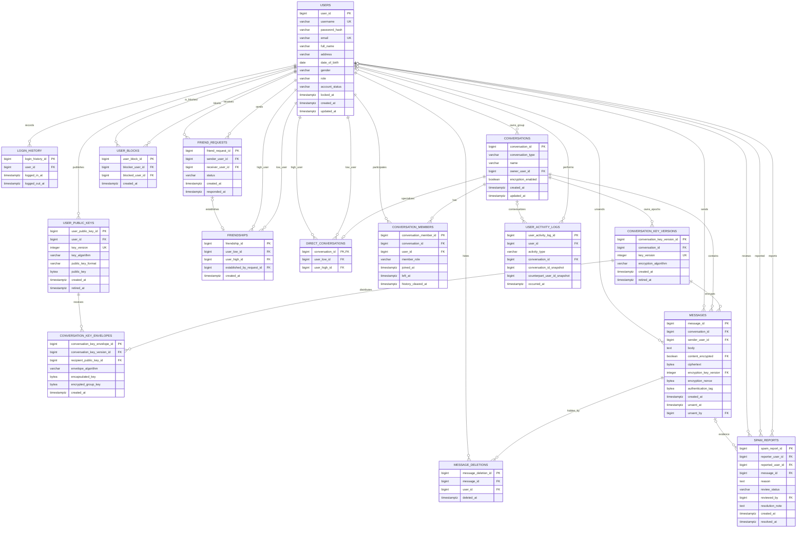

# Database V1 Entity-Relationship Diagram

## Scope

This diagram is the finalized fifteen-table Version 1 model. It describes storage supporting client-side end-to-end encrypted groups. Key generation, private-key protection, encryption/decryption, public-key authenticity, membership authorization, and atomic envelope distribution remain Version 2 work; SQL storage alone does not implement or prove E2EE.

## Cardinality notes

- A user can have many relationship/history rows, but self-relationships are rejected.
- Friendship and direct-conversation pairs are canonical unordered pairs (`low < high`).
- Every direct conversation has exactly one direct specialization by contract; this cross-table requirement is created transactionally in Version 2.
- A conversation has many membership rows and messages. A direct conversation must have two active members; a group must have an owner who is an active admin.
- The recipient model is per-user, with one active X25519 public key per user and retained retired keys for historical references; independent per-device keys are not modeled.
- A group's encryption mode is chosen at creation and is immutable by Version 2 server policy. The composite conversation/flag foreign key prevents message-state mismatches but does not prevent every update of `conversations.encryption_enabled`; no V1 trigger is added for that workflow rule.
- An encrypted group has client-generated key epochs. Each authorized recipient public key receives one opaque HPKE envelope for an epoch. PostgreSQL stores no private key or plaintext group key.
- Membership checks, complete envelope distribution, public-key authenticity, and atomic rotation after membership or public-key changes are Version 2 transaction responsibilities.
- Partial unique index `uq_messages_conversation_key_nonce` covers `(conversation_id, encryption_key_version, encryption_nonce)` for encrypted rows with a key version and nonce. It rejects retained duplicates within an epoch but cannot detect a nonce removed by unsending.
- A recalled message retains its identity, conversation, sender, creation time, and recall metadata while `body` is replaced by the non-null canonical `[Message unsent]` placeholder.
- A message can have multiple deletion rows, at most one per user, and can be referenced by reports. For encrypted content that reference supplies metadata only; administrators cannot decrypt it from server storage.
- Reports retain their own workflow independently from user account status.
- Deleting a conversation clears the live activity FK but retains conversation and direct-counterpart snapshots, `activity_type`, user, and time for historical/distinct statistics.
