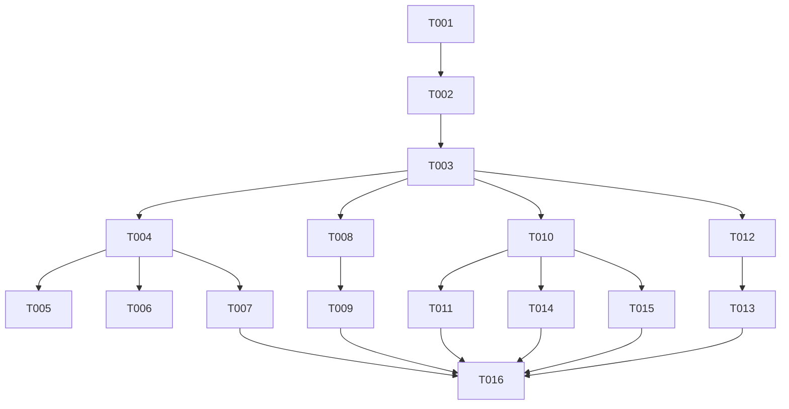

# Tasks: User Client UI Version 1

**Input**: Design documents from `specs/002-user-client-ui/`

**Prerequisites**: `plan.md`, `spec.md`, `research.md`, `data-model.md`, `contracts/ui-components.md`, `quickstart.md`

**Tests**: Focused JUnit tests are included alongside each behavior because the implementation plan and project constitution require verification for implemented behavior. The tasks are not TDD-ordered; each task adds or updates its focused test with the implementation.

**Organization**: Tasks are grouped by the five prioritized user stories. Each implementation task is a reviewable unit with a suggested separate commit message.

## Format: `- [ ] [ID] [P?] [Story?] Description`

- `[P]` marks tasks that can proceed in parallel without editing the same files or depending on incomplete work.
- `[US#]` links a task to its user story in `spec.md`.
- Every task names its target file paths. Suggested commit subjects are included so completed tasks can be committed individually.

## Phase 1: Setup

**Purpose**: Establish shared visual primitives for the User screens without adding dependencies.

- [X] T001 Define Admin-aligned colors, spacing, typography, and shared Swing component styling in `user-client/src/main/java/com/chat/user/component/UserUiTheme.java` (Commit: `feat(user): add shared UI theme tokens`)

## Phase 2: Foundational

**Purpose**: Build the shared presentation state and workspace shell required by every signed-in journey.

- [X] T002 Create the signed-in sample profile and session state in `user-client/src/main/java/com/chat/user/model/UserProfile.java` and `user-client/src/main/java/com/chat/user/model/UserSessionState.java`; include only project-required account fields, keep all state in memory, and add focused coverage in `user-client/src/test/java/com/chat/user/model/UserSessionStateTest.java` (Commit: `feat(user): add sample profile and session state`)
- [X] T003 Create the shared desktop navigation shell with destinations for Chats, Friends, Requests/Search, Groups, and Profile in `user-client/src/main/java/com/chat/user/view/UserMainFrame.java` and `user-client/src/main/java/com/chat/user/component/UserNavigationSidebar.java`; follow the Admin-aligned dark navy/blue chrome, leave feature panels registerable without server access, and add focused coverage in `user-client/src/test/java/com/chat/user/view/UserMainFrameTest.java` (Commit: `feat(user): add main workspace navigation shell`)

**Checkpoint**: Shared User theme, sample session, and navigable workspace shell are available; no screen depends on a live server.

## Phase 3: User Story 1 — Access and Set Up an Account (Priority: P1) 🎯 MVP

**Goal**: Let a person enter the sample User workspace and review account registration, recovery, profile, and password-change screens.

**Independent Test**: Launch the app without a running server; validate sign-in fields; follow the sample sign-in into the workspace; open registration, password recovery, and profile; verify cancel keeps the prior sample state and recovery never reveals a generated password.

### Implementation for User Story 1

- [X] T004 [US1] Implement the sign-in entry screen, required-field validation, sample navigation into `UserMainFrame`, and startup wiring in `user-client/src/main/java/com/chat/user/view/LoginPanel.java` and `user-client/src/main/java/com/chat/user/UserApplication.java`; add focused coverage in `user-client/src/test/java/com/chat/user/view/LoginPanelTest.java` (Commit: `feat(user): implement sign-in entry flow`)
- [X] T005 [P] [US1] Implement the registration dialog with project-required account fields, inline validation, and cancel/submit sample states in `user-client/src/main/java/com/chat/user/view/RegistrationDialog.java`; add focused coverage in `user-client/src/test/java/com/chat/user/view/RegistrationDialogTest.java` (Commit: `feat(user): add account registration dialog`)
- [X] T006 [P] [US1] Implement the password-recovery dialog with email validation and a neutral sample confirmation that never displays a generated password in `user-client/src/main/java/com/chat/user/view/PasswordRecoveryDialog.java`; add focused coverage in `user-client/src/test/java/com/chat/user/view/PasswordRecoveryDialogTest.java` (Commit: `feat(user): add password recovery dialog`)
- [ ] T007 [P] [US1] Implement profile editing and a separate change-password dialog using only project-required fields, with save/cancel and sample feedback in `user-client/src/main/java/com/chat/user/view/ProfileSettingsPanel.java` and `user-client/src/main/java/com/chat/user/view/ChangePasswordDialog.java`; add focused coverage in `user-client/src/test/java/com/chat/user/view/ProfileSettingsPanelTest.java` (Commit: `feat(user): add profile and password settings`)

**Checkpoint**: Story 1 screens are independently navigable and operate on sample state only.

## Phase 4: User Story 2 — Find and Manage Friend Connections (Priority: P1)

**Goal**: Let the signed-in user view/filter friends, inspect online status, handle requests, search people, and perform confirmed relationship actions.

**Independent Test**: Use deterministic sample entries to filter friends and requests, show online-only users, accept/decline a request, search by username/full name, verify blocked users are excluded, and cancel block/unfriend prompts without changing state.

### Implementation for User Story 2

- [ ] T008 [US2] Add friend presentation state and implement the friends list with name filtering, online/offline and online-only views, open-chat action, and confirmed local unfriend/block actions in `user-client/src/main/java/com/chat/user/model/FriendEntry.java`, `user-client/src/main/java/com/chat/user/view/FriendsPanel.java`, and `user-client/src/test/java/com/chat/user/view/FriendsPanelTest.java` (Commit: `feat(user): implement friends list and relationship actions`)
- [ ] T009 [US2] Implement incoming friend-request filtering/accept/decline and username/full-name search that omits accounts blocked by the current user in `user-client/src/main/java/com/chat/user/model/FriendRequest.java` and `user-client/src/main/java/com/chat/user/view/FriendRequestsSearchPanel.java`; add focused coverage in `user-client/src/test/java/com/chat/user/view/FriendRequestsSearchPanelTest.java` (Commit: `feat(user): add friend requests and user search`)

**Checkpoint**: Story 2 can be exercised with sample profiles without authentication/network dependencies.

## Phase 5: User Story 3 — Have a One-to-One Conversation (Priority: P1)

**Goal**: Let the user open a personal chat, inspect sample messages, search history, navigate to results, and access distinct local message/history actions.

**Independent Test**: Open a sample conversation; search in the current conversation and globally; select a result to navigate to its message; verify Delete for Me, Unsend, and Clear Conversation History are distinct; cancel each confirmation and verify the sample state remains unchanged.

### Implementation for User Story 3

- [ ] T010 [US3] Add personal conversation/message presentation models and implement the conversation list, message history, and composer in `user-client/src/main/java/com/chat/user/model/Conversation.java`, `user-client/src/main/java/com/chat/user/model/ChatMessage.java`, `user-client/src/main/java/com/chat/user/view/ChatWorkspacePanel.java`, and `user-client/src/main/java/com/chat/user/component/MessageBubble.java`; add focused coverage in `user-client/src/test/java/com/chat/user/view/ChatWorkspacePanelTest.java` (Commit: `feat(user): implement personal chat workspace`)
- [ ] T011 [US3] Implement in-conversation/global history search with result navigation, plus separate confirmed local states for Delete for Me, Unsend, and Clear Conversation History in `user-client/src/main/java/com/chat/user/view/ChatHistorySearchPanel.java` and `user-client/src/main/java/com/chat/user/model/ChatHistoryActions.java`; add focused coverage in `user-client/src/test/java/com/chat/user/view/ChatHistorySearchPanelTest.java` (Commit: `feat(user): add chat history search and message actions`)

**Checkpoint**: Story 3 works on sample messages and makes no claims about live delivery, durable storage, or shared deletion.

## Phase 6: User Story 4 — Create and Participate in Group Conversations (Priority: P2)

**Goal**: Let the user create/manage groups, inspect member roles, and view a group conversation with a clearly mock encryption indicator.

**Independent Test**: Reject group creation without another username; create a group with at least one other participant; rename it, edit membership and administrator role in sample state, and open the group conversation.

### Implementation for User Story 4

- [ ] T012 [US4] Add group/member presentation models and implement the group list, create-group flow requiring at least one other username, rename/add/remove/admin controls, and member-role view in `user-client/src/main/java/com/chat/user/model/GroupConversation.java`, `user-client/src/main/java/com/chat/user/model/GroupMember.java`, `user-client/src/main/java/com/chat/user/view/GroupsPanel.java`, `user-client/src/main/java/com/chat/user/view/CreateGroupDialog.java`, and `user-client/src/main/java/com/chat/user/view/GroupMembersDialog.java`; add focused coverage in `user-client/src/test/java/com/chat/user/view/GroupsPanelTest.java` (Commit: `feat(user): implement group creation and management`)
- [ ] T013 [US4] Implement the group conversation message view and composer, show group administrator/member roles, and mark encryption as a visual non-functional placeholder in `user-client/src/main/java/com/chat/user/view/GroupChatPanel.java`; add focused coverage in `user-client/src/test/java/com/chat/user/view/GroupChatPanelTest.java` (Commit: `feat(user): implement group chat screen`)

**Checkpoint**: Story 4 group controls are sample-only, enforce the minimum-other-member rule, and do not claim cryptographic protection.

## Phase 7: User Story 5 — Report an Account and Use Message Assistance (Priority: P2)

**Goal**: Let the user submit a sample report from an eligible prior conversation and preview/accept/discard a sample writing suggestion or revision.

**Independent Test**: Open reporting only from an account with prior sample chat; require a reason and confirm sample feedback. Open writing assistance from a draft, preview suggestion/revision, discard without changing the draft, and accept to update the composer.

### Implementation for User Story 5

- [ ] T014 [P] [US5] Implement a spam-report dialog tied to an account with prior sample chat interaction, require a reason, and show sample-only confirmation in `user-client/src/main/java/com/chat/user/view/SpamReportDialog.java`; add focused coverage in `user-client/src/test/java/com/chat/user/view/SpamReportDialogTest.java` (Commit: `feat(user): add spam report dialog`)
- [ ] T015 [P] [US5] Implement writing-assistance suggestion/revision previews with explicit accept/discard behavior and no provider call in `user-client/src/main/java/com/chat/user/view/WritingAssistDialog.java`; add focused coverage in `user-client/src/test/java/com/chat/user/view/WritingAssistDialogTest.java` (Commit: `feat(user): add writing assistance preview`)

**Checkpoint**: Story 5 flows preserve user control and do not imply a report or LLM request reached an external service.

## Phase 8: Polish & Cross-Cutting Concerns

**Purpose**: Wire all screens into the final User journey, validate the agreed scope, and verify the build.

- [ ] T016 Integrate all approved screens and contextual actions in `user-client/src/main/java/com/chat/user/view/UserMainFrame.java`, verify and correct scope/labels against `specs/002-user-client-ui/spec.md`, and complete the manual and Maven scenarios in `specs/002-user-client-ui/quickstart.md`; capture implemented UI evidence under `docs/screenshots/user/implemented/` without overwriting Stitch references, update `AI-LOG.md`, and commit the verified integration (Commit: `feat(user): integrate and verify user UI v1`)

---

## Dependencies & Execution Order

### Phase Dependencies

- **Setup (Phase 1)**: No dependencies; T001 establishes shared visual styling.
- **Foundational (Phase 2)**: T002 depends on T001; T003 depends on T001 and T002. These are prerequisites for all story views.
- **User Stories (Phases 3–7)**: Begin after the shell is available. Follow the listed priority sequence for implementation and review; each story can be independently exercised with sample state once its tasks are done.
- **Polish (Phase 8)**: Depends on all five desired user stories and integrates their routes/actions.

### User Story Dependencies

- **US1 (P1)**: Starts after the foundation; it provides the sign-in route and profile settings.
- **US2 (P1)**: Starts after the foundation; it can be checked in the workspace with fixtures, then reached through the integrated shell.
- **US3 (P1)**: Starts after the foundation; conversation fixtures make personal chat independently checkable.
- **US4 (P2)**: Starts after the foundation; group fixtures make group creation/chat independently checkable.
- **US5 (P2)**: Starts after the foundation; it depends on an eligible sample conversation for reporting and a sample draft for writing assistance, both supplied by fixtures/US3. Complete US3 before US5 integration.

### Within Each User Story

- Complete a task's implementation and focused test together, run the focused test, review the result, then create the task's suggested commit.
- Complete tasks that share a model or view sequentially; tasks marked `[P]` modify separate files and can be implemented in parallel after their phase prerequisites.
- Do not begin an integration task until all referenced story components are available.

### Parallel Opportunities

- **US1**: T005 registration, T006 recovery, and T007 profile/password surfaces use separate views/tests and can be developed in parallel after T004 has established the entry flow and shared foundation.
- **US5**: T014 spam report and T015 writing assistance use separate dialog/test files and can be developed in parallel after the sample conversation/composer contract is available.
- **Across stories**: Once the foundation is complete, US2, US3, and US4 are independently fixture-testable, but should be integrated in priority order to keep review manageable.

## Independent Acceptance Criteria by Story

- **US1**: Sign-in validation, sample workspace entry, registration, recovery confirmation, editable profile and password form all work without a running server; cancellation preserves state.
- **US2**: Name filters and online-only view work; request state changes locally; search supports username/full name and excludes the current user's blocked accounts; relationship actions require confirmation.
- **US3**: Personal messages display and search; search result navigation selects the correct conversation/message; all three destructive actions are distinct, confirmed, local-only, and cancellable.
- **US4**: Group creation rejects zero additional participants; member/role actions update sample state; group chat opens; encryption is explicitly a placeholder.
- **US5**: Reporting requires prior interaction and a reason; writing assistance previews both modes and only changes a draft when accepted.

## Implementation Strategy

### MVP First (User Story 1)

1. Complete T001–T003 for theme, sample session, and workspace shell.
2. Complete T004–T007 for account entry, registration/recovery, and profile/password settings.
3. Stop and independently validate US1 using `mvn -pl user-client -am test` plus the account scenario in `quickstart.md`.
4. Review and commit one completed task at a time; do not push automatically.

### Incremental Delivery

1. Complete Setup and Foundation.
2. Deliver US1 account access as the first demonstrable increment.
3. Deliver US2 friend management and discovery.
4. Deliver US3 personal chat and history operations.
5. Deliver US4 group management and chat.
6. Deliver US5 reporting and writing assistance.
7. Integrate and verify the entire flow, then run `mvn clean verify`.

## Notes

- `[P]` tasks operate on separate files and have no dependency on unfinished work.
- User story labels map directly to `spec.md`.
- Each implementation task includes its file paths and suggested commit subject to support the requested one-task/one-commit workflow.
- Generated HTML and screenshots are visual references, not the delivered Java implementation.
- Keep any future changes to `common`, `server`, database schemas, protocol, credentials, email, LLM provider, and encryption outside this Version 1 UI scope unless separately approved.
