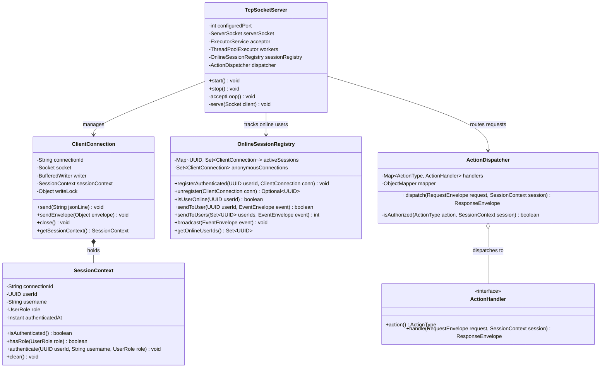
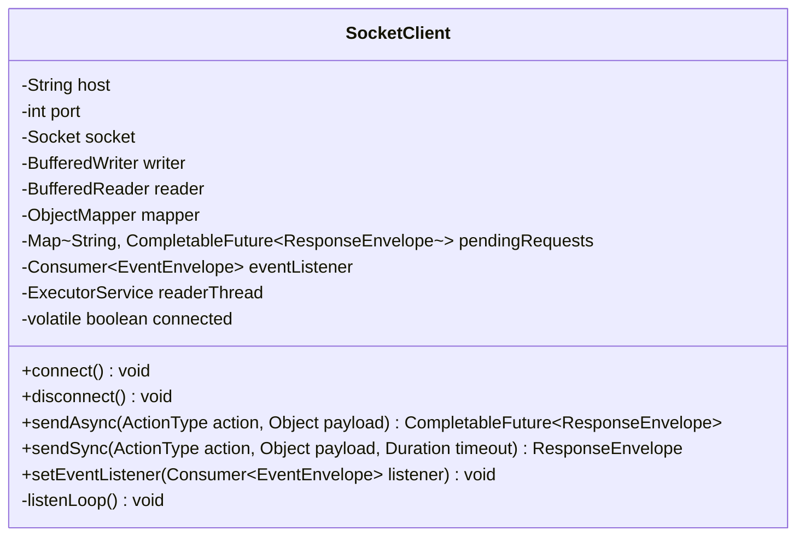

# Data Model & Class Design: Server Core Platform

**Feature**: `specs/005-server-core` | **Date**: 2026-11-23

## Server In-Memory Models & Core Components



### Component Details

#### 1. `SessionContext`
- **Location**: `com.chat.server.session.SessionContext`
- **Purpose**: Encapsulates authentication state and security identity associated with a single TCP socket connection.
- **Fields**:
  - `connectionId` (String): Unique identifier for the socket connection (e.g., UUID).
  - `userId` (UUID): Unique user ID in database once authenticated (null if anonymous).
  - `username` (String): Username once authenticated (null if anonymous).
  - `role` (UserRole): Role from `common` (`USER` or `ADMIN`).
  - `authenticatedAt` (Instant): Timestamp when authentication succeeded.
- **State Invariants**:
  - `isAuthenticated()` is true if and only if `userId != null && role != null`.

#### 2. `ClientConnection`
- **Location**: `com.chat.server.socket.ClientConnection`
- **Purpose**: Thread-safe abstraction wrapping a client `Socket`, its output stream, and its associated `SessionContext`.
- **Concurrency Guard**:
  - Writes to `BufferedWriter` are synchronized via an internal `writeLock` so that response frames and server push event frames never interleave.

#### 3. `OnlineSessionRegistry`
- **Location**: `com.chat.server.session.OnlineSessionRegistry`
- **Purpose**: Tracks active user sessions and routes push events.
- **Storage**:
  - `ConcurrentHashMap<UUID, Set<ClientConnection>>`: Maps a `userId` to active connections. Supports multiple simultaneous logins by the same user if allowed, or tracks all sockets.
  - `Set<ClientConnection>`: Tracks connected but unauthenticated sockets.
- **Key Methods**:
  - `sendToUser(UUID userId, EventEnvelope event)`: Serializes the event and writes it to all active sockets of the user.
  - `broadcast(EventEnvelope event)`: Sends to all authenticated sessions.

#### 4. `ActionHandler` & `ActionDispatcher`
- **Location**: `com.chat.server.handler`
- **Purpose**: Central routing of protocol requests with security validation.
- **Security Logic**:
  ```text
  If action == PING, LOGIN, ADMIN_LOGIN, REGISTER, RECOVER_PASSWORD:
      Allow execution
  Else if !session.isAuthenticated():
      Return ResponseEnvelope(id, false, null, UNAUTHENTICATED, "Authentication required")
  Else if action.name().startsWith("ADMIN_") && session.getRole() != UserRole.ADMIN:
      Return ResponseEnvelope(id, false, null, UNAUTHORIZED, "Admin privileges required")
  Else if handler == null:
      Return ResponseEnvelope(id, false, null, UNSUPPORTED_OPERATION, "Operation not implemented yet")
  Else:
      Execute handler.handle(request, session)
  ```

---

## Client-Side Networking Adapter (`SocketClient`)



- **Location**: `com.chat.client.net.SocketClient` (or package in `common` / client module)
- **Fields**:
  - `pendingRequests`: `ConcurrentHashMap<String, CompletableFuture<ResponseEnvelope>>` indexed by `requestId`.
  - `eventListener`: Callback executed when an `EventEnvelope` arrives.
- **Thread Safety**:
  - `sendAsync` synchronizes writing to socket.
  - `listenLoop` continuously reads frames on a dedicated background thread, safely dispatching events and completing futures.
