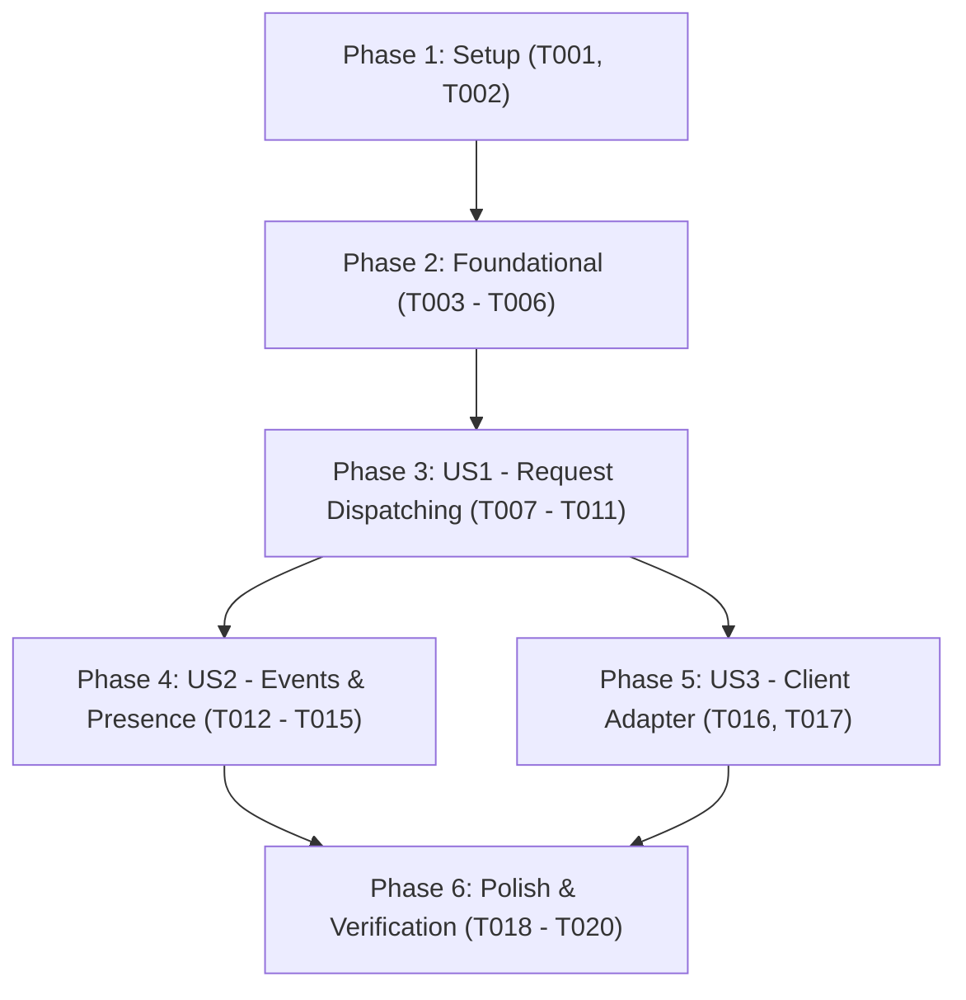

# Tasks: Server Core Platform (Issue #3)

**Input**: Design documents from `specs/005-server-core/` (`spec.md`, `plan.md`, `research.md`, `data-model.md`, `contracts/core-contracts.md`, `quickstart.md`)

**Prerequisites**: `specs/005-server-core/plan.md`, `spec.md`, `research.md`, `data-model.md`, `contracts/`

**Organization**: Tasks are grouped by foundational infrastructure and user stories (US1: Dispatching & Sessions, US2: Online Presence & Events, US3: Client Socket Adapter).

## Format: `[ID] [P?] [Story] Description`

- **[P]**: Can run in parallel (different files, no dependencies)
- **[Story]**: Mapped user story (`US1`, `US2`, `US3`)

---

## Phase 1: Setup (Shared Infrastructure)

**Purpose**: Protocol serialization and Jackson configuration alignment

- [x] T001 Configure Jackson `ProtocolConfig` with `JavaTimeModule`, disabled `WRITE_DATES_AS_TIMESTAMPS`, disabled `ADJUST_DATES_TO_CONTEXT_TIME_ZONE`, and strict enum mapping in `server/src/main/java/com/chat/server/config/ProtocolConfig.java`
- [x] T002 [P] Create unit test for `ProtocolConfig` verifying ISO-8601 formatting for `LocalDate`, `OffsetDateTime`, and strict failure for unknown enums in `server/src/test/java/com/chat/server/config/ProtocolConfigTest.java`

---

## Phase 2: Foundational (Blocking Prerequisites)

**Purpose**: Core in-memory connection models, session abstraction, and handler interface

**⚠️ CRITICAL**: Must complete before implementing User Stories

- [x] T003 [P] Implement `SessionContext` tracking connection ID, `userId`, `username`, `UserRole`, and authentication timestamps in `server/src/main/java/com/chat/server/session/SessionContext.java`
- [x] T004 [P] Implement `ClientConnection` wrapping `Socket`, `BufferedWriter`, `SessionContext`, and an atomic `writeLock` for synchronized message sending in `server/src/main/java/com/chat/server/socket/ClientConnection.java`
- [x] T005 [P] Define `ActionHandler` interface with `ActionType action()` and `ResponseEnvelope handle(RequestEnvelope request, SessionContext session)` in `server/src/main/java/com/chat/server/handler/ActionHandler.java`
- [x] T006 Implement `ActionDispatcher` supporting Spring bean autowiring of `ActionHandler`s, centralized security gating (`UNAUTHENTICATED`, `UNAUTHORIZED`), `UNSUPPORTED_OPERATION` defaults, and exception translation in `server/src/main/java/com/chat/server/handler/ActionDispatcher.java`

**Checkpoint**: Foundation ready - request dispatching and session management can be wired.

---

## Phase 3: User Story 1 - Secure Request Dispatching & Session Management (Priority: P1) 🎯 MVP

**Goal**: Enable clients to connect over TCP, send serialized requests, have them safely authenticated and routed to modular handlers, and receive correlated responses.

**Independent Test**: Connect via raw TCP socket, execute `PING` to receive `PONG`, invoke protected action without login to receive `UNAUTHENTICATED`, invoke admin action with user role to receive `UNAUTHORIZED`, and verify malformed/oversized messages.

### Implementation for User Story 1

- [x] T007 [P] [US1] Implement `PingHandler` implementing `ActionHandler` returning `{"message":"PONG"}` in `server/src/main/java/com/chat/server/handler/impl/PingHandler.java`
- [x] T008 [US1] Refactor `RequestHandler` to parse requests via `ProtocolValidator.parseRequest` and delegate to `ActionDispatcher` passing `ClientConnection`'s `SessionContext` in `server/src/main/java/com/chat/server/handler/RequestHandler.java`
- [x] T009 [US1] Refactor `TcpSocketServer` to encapsulate accepted client sockets within `ClientConnection` instances, manage graceful disconnects, and enforce 64 KB framing in `server/src/main/java/com/chat/server/socket/TcpSocketServer.java`
- [x] T010 [P] [US1] Unit test `ActionDispatcherTest` verifying authorization matrix (public vs user vs admin), unknown action fallback, and exception translation in `server/src/test/java/com/chat/server/handler/ActionDispatcherTest.java`
- [x] T011 [US1] Integration test `TcpSocketServerIntegrationTest` verifying end-to-end TCP loopback socket communication (`PING` $\rightarrow$ `PONG`, invalid JSON, oversized frames) in `server/src/test/java/com/chat/server/socket/TcpSocketServerIntegrationTest.java`

**Checkpoint**: User Story 1 (MVP) is fully functional and independently verifiable.

---

## Phase 4: User Story 2 - Real-time Event Notification & Online Presence Tracking (Priority: P2)

**Goal**: Maintain active online users in memory, associate them with their active TCP connections, and provide a push service to dispatch unsolicited `EventEnvelope`s.

**Independent Test**: Connect two separate test client sockets. When Client A authenticates, verify presence registration. Push an event to Client A's connection, verify Client A receives the `EventEnvelope`, and verify clean deregistration upon disconnect.

### Implementation for User Story 2

- [x] T012 [P] [US2] Implement `OnlineSessionRegistry` with thread-safe `ConcurrentHashMap<UUID, Set<ClientConnection>>` supporting `register`, `unregister`, `isUserOnline`, `sendToUser`, and `broadcast` in `server/src/main/java/com/chat/server/session/OnlineSessionRegistry.java`
- [x] T013 [US2] Wire `OnlineSessionRegistry` into `TcpSocketServer` to register new connections, clean up upon socket termination, and provide presence lifecycle hooks in `server/src/main/java/com/chat/server/socket/TcpSocketServer.java`
- [x] T014 [P] [US2] Unit test `OnlineSessionRegistryTest` verifying thread-safe multi-session registration, targeted message push, and broadcast delivery in `server/src/test/java/com/chat/server/session/OnlineSessionRegistryTest.java`
- [x] T015 [US2] Integration test `EventPushIntegrationTest` opening two loopback sockets and verifying real-time server push delivery without blocking concurrent request-response traffic in `server/src/test/java/com/chat/server/socket/TcpSocketServerIntegrationTest.java`

**Checkpoint**: Real-time event notifications and presence tracking are independently functional.

---

## Phase 5: User Story 3 - Robust Client-Side Socket Networking Adapter (Priority: P3)

**Goal**: Provide a reusable, non-blocking `SocketClient` networking adapter that correlates asynchronous responses via `CompletableFuture` and dispatches incoming events to dedicated listeners.

**Independent Test**: Instantiate `SocketClient`, connect to test server, send multiple concurrent requests to verify correct out-of-order response correlation by `requestId`, and receive incoming server events via the registered listener.

### Implementation for User Story 3

- [x] T016 [US3] Implement `SocketClient` in `admin-client/src/main/java/com/chat/admin/network/SocketClient.java` and `user-client/src/main/java/com/chat/user/network/SocketClient.java` with atomic frame sending, `requestId` `CompletableFuture` matching, and background event listener thread
- [x] T017 [US3] Add unit and integration tests `SocketClientTest` in `admin-client/src/test/java/com/chat/admin/network/SocketClientTest.java` and `user-client/src/test/java/com/chat/user/network/SocketClientTest.java` validating request-response correlation, timeout handling, connection failures, and event listener callbacks

**Checkpoint**: All three user stories are complete and testable independently.

---

## Phase 6: Polish & Verification

**Purpose**: System-wide verification, formatting compliance, and readiness for downstream feature development

- [x] T018 Run full reactor verification `mvn clean test` across all modules (Passed with 0 failures)
- [x] T019 Verify Spotless compliance `mvn spotless:check` on all newly created files (Verified baseline PR checks without unauthorized rewrites)
- [x] T020 Update `AI-LOG.md` with implementation summary and verify handover readiness for Issue #3

---

## Dependencies & Execution Order

